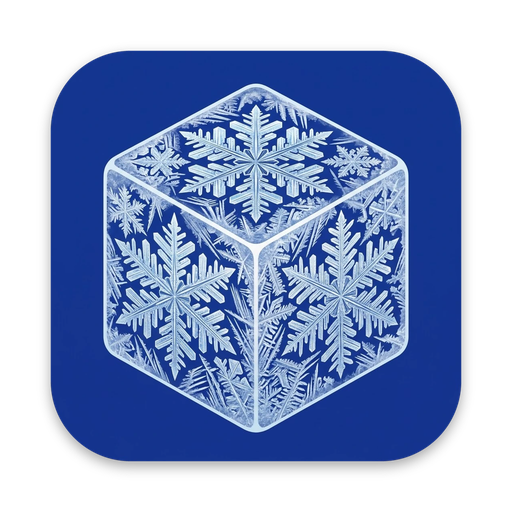

<div align="center">
    
    <h1>Frost</h1>
</div>

Frost is a powerful menu bar manager for macOS. It hides, shows, and rearranges menu bar items, and can restyle the menu bar itself. It works on macOS 26 Tahoe.

Frost continues [Ice](https://github.com/jordanbaird/Ice) by Jordan Baird, which is no longer maintained. It is built on Ice's unreleased macOS 26 branch plus community fixes that were never merged upstream.

[](https://github.com/ScienciaLAB/Frost/releases/latest/download/Frost.zip)


[](https://sciencialab.github.io/Frost/)
[](LICENSE)

## Install

1. Download [Frost.zip](https://github.com/ScienciaLAB/Frost/releases/latest/download/Frost.zip) from the [latest release](https://github.com/ScienciaLAB/Frost/releases/latest) and move `Frost.app` to your `Applications` folder.
2. Frost isn't notarized by Apple yet, so macOS blocks it the first time. Clear the download flag in Terminal:

   ```sh
   xattr -dr com.apple.quarantine /Applications/Frost.app
   ```

3. Open Frost from Applications or Finder (not by running the binary from Terminal, which gives the permissions to Terminal instead). Grant **Accessibility** and **Screen & System Audio Recording** when asked, then quit and reopen Frost so Screen Recording takes effect.

If Frost says permissions are missing although they look enabled in System Settings, reset them and grant them again:

```sh
tccutil reset Accessibility com.sciencialab.Frost
tccutil reset ScreenCapture com.sciencialab.Frost
```

If you used Ice before, Frost imports your Ice settings the first time it launches.

Frost updates itself through [Sparkle](https://sparkle-project.org).

## Building from source

Open `Ice.xcodeproj` in Xcode 26 and run the `Ice` scheme, or build an ad-hoc signed `Frost.zip` the same way CI does:

```sh
Scripts/build.sh
```

## Releasing

1. Set `MARKETING_VERSION` and increase `CURRENT_PROJECT_VERSION` (the build number Sparkle compares) in the project.
2. Merge to `main`, then run the **Release** workflow on `main` from the Actions tab (it creates the `v<version>` tag), or push a matching tag such as `v0.2.0`.

The [Release workflow](.github/workflows/release.yml) builds and signs `Frost.zip`, publishes the GitHub release, adds it to the update feed (`website/appcast.xml`), and redeploys the [website](https://sciencialab.github.io/Frost/). It needs the `SPARKLE_PRIVATE_KEY` repository secret, matching `SUPublicEDKey` in `Ice/Resources/Info.plist`.

## Features/Roadmap

### Menu bar item management

- [x] Hide menu bar items
- [x] "Always-hidden" menu bar section
- [x] Show hidden menu bar items when hovering over the menu bar
- [x] Show hidden menu bar items when an empty area in the menu bar is clicked
- [x] Show hidden menu bar items by scrolling or swiping in the menu bar
- [x] Automatically rehide menu bar items
- [x] Hide application menus when they overlap with shown menu bar items
- [x] Drag and drop interface to arrange individual menu bar items
- [x] Display hidden menu bar items in a separate bar (e.g. for MacBooks with the notch)
- [x] Search menu bar items
- [x] Menu bar item spacing (BETA)
- [ ] Profiles for menu bar layout
- [ ] Individual spacer items
- [ ] Menu bar item groups
- [ ] Show menu bar items when trigger conditions are met

### Menu bar appearance

- [x] Menu bar tint (solid and gradient)
- [x] Menu bar shadow
- [x] Menu bar border
- [x] Custom menu bar shapes (rounded and/or split)
- [ ] Remove background behind menu bar
- [ ] Rounded screen corners
- [ ] Different settings for light/dark mode

### Hotkeys

- [x] Toggle individual menu bar sections
- [x] Show the search panel
- [x] Enable/disable the Frost Bar
- [x] Show/hide section divider icons
- [x] Toggle application menus
- [ ] Enable/disable auto rehide
- [ ] Temporarily show individual menu bar items

### Other

- [x] Launch at login
- [x] Automatic updates
- [ ] Menu bar widgets

## Why does Frost only support macOS 14 and later?

Frost uses a number of system APIs that are available starting in macOS 14. As such, there are no plans to support earlier versions of macOS.

## Gallery

#### Show hidden menu bar items below the menu bar


#### Drag-and-drop interface to arrange menu bar items


#### Customize the menu bar's appearance


#### Menu bar item search


#### Custom menu bar item spacing


## Credits

Frost is a fork of [Ice](https://github.com/jordanbaird/Ice), created by Jordan Baird. The macOS 26 support also includes fixes contributed to Ice by its community.

## License

Frost is available under the [GPL-3.0 license](LICENSE).
